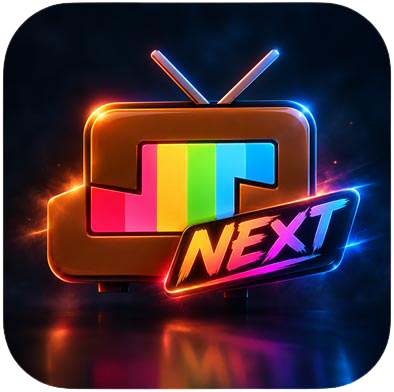

<div align="center">
  
  <h1>سینماگرافی NEXT (CinemaGraphy NEXT)</h1>
  <p><strong>افزونه پیشرفته استریمیو و نوویو برای دسترسی به فیلم، سریال و انیمه از منابع ایرانی</strong></p>

  <p>
    <a href="https://github.com/TheNerdCow/CinemaGraphy-next/releases"></a>
    
    
    
  </p>
</div>

---

## 🌟 درباره پروژه
**CinemaGraphy NEXT** یک افزونه (Addon) مدرن، سریع و چندمنبعی برای پلتفرم‌های پخش فیلم و سریال **Stremio** و **Nuvio** است که به طور ویژه برای دسترسی به آرشیوها و منابع محتوایی ایران طراحی شده است. 

این پروژه با تمرکز بر سرعت بالا، رابط کاربری تمیز و بدون نیاز به کلیدهای پیچیده متا (`Cinemeta`) توسعه یافته است.

---

## ✨ ویژگی‌های کلیدی
* **پشتیبانی از چند منبع معتبر ایرانی:** شامل منابع رایگان (`F2Media`, `Cinamatic`, `AslMoviez`) و منابع اشتراکی (`AvaMovie`, `DigiMovie`).
* **بدون نیاز به کلید متا اجباری:** اتصال هوشمند و مستقل برای دریافت اطلاعات فیلم و سریال.
* **شخصی‌سازی دقیق کاتالوگ‌ها:** امکان انتخاب جداگانه دسته‌بندی‌ها (دوبله، انیمه، هندی، کره‌ای، انیمیشن) برای هر منبع.
* **صفحه پیکربندی (Landing Page) مدرن:** طراحی شده به صورت تک‌صفحه‌ای با افکت Liquid Glass، کاملاً ریسپانسیو و راست‌چین.
* **بررسی زنده وضعیت منابع:** قابلیت تست و نمایش آنلاین یا آفلاین بودن دامنه‌های منابع به صورت خودکار (با دور زدن Cloudflare).

---

## 🚀 نصب و راه‌اندازی سریع

### ۱. نصب عمومی (پیش‌فرض)
می‌توانید مانیفست عمومی افزونه را مستقیماً با لینک زیر روی Stremio یا Nuvio خود نصب کنید:
> `https://your-domain.com/manifest.json`

### ۲. نصب شخصی‌سازی‌شده (مختص خودتان)
1. وارد صفحه اصلی افزونه شوید.
2. از بخش **نصب و پیکربندی مانیفست**، منابع مورد نظر خود را تیک بزنید.
3. در منوی باز شده زیر هر منبع، کاتالوگ‌های دلخواه خود را (مثلاً فقط دوبله‌ها یا انیمه‌ها) انتخاب کنید.
4. در صورت انتخاب منابع اشتراکی (مثل AvaMovie)، کوکی نشست خود را وارد کنید.
5. روی دکمه **ساخت مانیفست شخصی** کلیک کنید و لینک اختصاصی خود را با یک کلیک در پلتفرم دلخواه نصب کنید.

---

## 🛠 راه‌اندازی روی سرور شخصی (Self-Hosting)

اگر می‌خواهید این افزونه را روی هاست شخصی یا سرور خود اجرا کنید:

1. مخزن را کلون کنید:
   ```bash
   git clone [https://github.com/TheNerdCow/CinemaGraphy-next.git](https://github.com/TheNerdCow/CinemaGraphy-next.git)
   cd CinemaGraphy-next